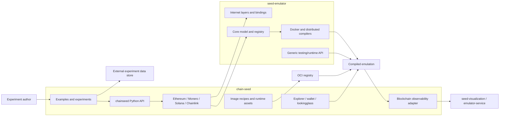
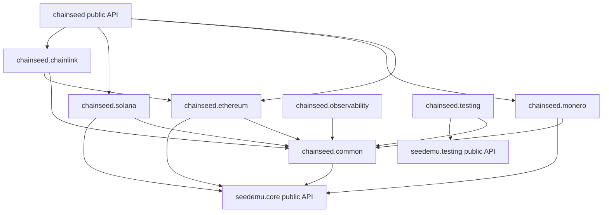
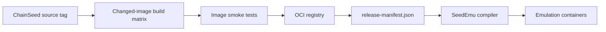
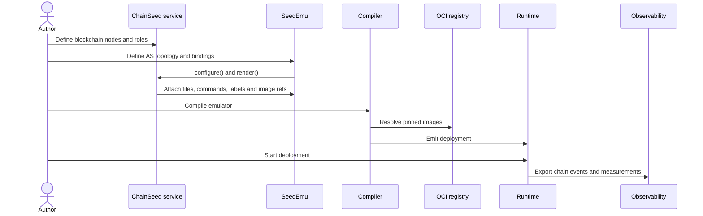
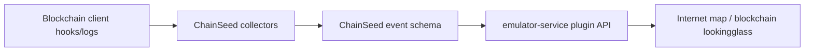

# ChainSeed Architecture

[中文](architecture.zh-CN.md) | English

## System Boundary



The SeedEmu package, repository, and CI have no ChainSeed dependency. SeedEmu
tests only its own generic emulator behavior. ChainSeed owns the compatibility
suite and runs it against a supplied SeedEmu candidate revision.

## Ownership

| Concern | `seed-emulator` | `chain-seed` |
|---|---|---|
| Internet, AS, network, routing, binding | Owns | Uses |
| Emulator registry and layer lifecycle | Owns | Extends |
| Docker/distributed compilation | Owns | Supplies node requirements |
| Generic container runtime and packet capture | Owns | Uses |
| Ethereum, Monero, Solana, Chainlink services | No | Owns |
| Genesis, accounts, wallets, faucets | No | Owns |
| Blockchain client image recipes | No | Owns |
| Explorer and blockchain lookingglass | No | Owns |
| Blockchain examples and runtime tests | No | Owns |
| Large-scale experiment definitions | No | Owns |
| Raw benchmark and topology datasets | No | References externally |

Kubo/IPFS and generic traffic generation remain in SeedEmu because they are
protocol-independent services. Chainlink moves to ChainSeed because its model
depends on Ethereum services and artifacts.

## Repository Layout

```text
chain-seed/
├── pyproject.toml
├── chainseed/
│   ├── extension.py
│   ├── common/
│   ├── compiler/
│   ├── ethereum/
│   │   └── LookingglassServer/
│   ├── monero/
│   ├── solana/
│   ├── chainlink/
│   └── testing/
├── images/
│   ├── ethereum/
│   ├── ethexplorer/
│   ├── monero/
│   ├── solana/
│   └── chainlink/
├── tools/
│   ├── blockchain/
│   ├── ethereum/
│   │   ├── large_scale/
│   │   └── transaction_generator/
│   ├── monero/large_scale/
│   └── solana/large_scale/
├── examples/
│   ├── D00_ethereum_poa/
│   ├── D01_ethereum_pos/
│   ├── ...
│   ├── D60_monero/
│   ├── D61_large_scale/
│   │   ├── ethereum/
│   │   ├── monero/
│   │   └── solana/
│   ├── D70_solana/
│   └── ...
├── experiments/legacy/
├── tests/
└── docs/
```

Each chain package owns its service layer, server roles, chain configuration,
and generated runtime artifacts. Shared code is admitted to `common/` only
after at least two chain implementations require the same abstraction.

### Core Module Responsibilities

| Module | Responsibility |
|---|---|
| `extension` | ChainSeed version, SeedEmu API requirement, owned layers and schemas |
| `common.artifacts` | Typed handoff of genesis, accounts, endpoints and release manifests |
| `common.systems` | Compiler-neutral runtime system profiles |
| `compiler.images` | Platform-specific OCI image mappings |
| `compiler.ChainSeedDocker` | ChainSeed image selection and deployment components |
| `common.labels` | Versioned node discovery and observability labels |
| `common.runtime` | Shared process-start and readiness declarations |
| `ethereum.service` | PoW/PoA/PoS network lifecycle and virtual-role binding |
| `ethereum.servers` | Execution, beacon, validator, faucet and utility roles |
| `ethereum.genesis` | Execution and consensus genesis generation |
| `ethereum.accounts` | Deterministic accounts, keys and validator deposits |
| `monero.service` | Monero network lifecycle and role binding |
| `monero.servers` | Daemon, miner and wallet roles |
| `monero.network` | Network identity, genesis and peer configuration |
| `solana.service` | Solana cluster lifecycle and validator binding |
| `solana.servers` | Bootstrap, validator, RPC and transaction roles |
| `solana.cluster` | Ledger bootstrap, identity, stake and entrypoint artifacts |
| `chainlink.service` | Oracle topology and Ethereum dependency resolution |
| `chainlink.servers` | Chainlink node, user and contract-deployment roles |
| `observability` | Blockchain event schema, collection and visualization adapter |
| `testing` | Protocol-aware health, transaction, block and finality probes |

## Module Dependencies



Chain packages must not import one another except for an explicit protocol
dependency such as Chainlink using Ethereum. Circular imports are forbidden.
Explicit SeedEmu imports are preferred in library modules so dependency changes
remain visible. Existing educational examples may use wildcard imports; this is
a style and maintainability concern, not a violation of dependency direction.

## SeedEmu Extension Contract

ChainSeed depends on a small public surface rather than compiler internals.

| Contract | Required operations |
|---|---|
| Layer lifecycle | register, configure, render, declare dependencies |
| Service lifecycle | install virtual servers, bind servers to nodes, retrieve targets |
| Node specification | software, files, build commands, start commands, labels, storage, ports |
| Network model | AS/network lookup, addresses, interfaces, bindings and filters |
| Artifact exchange | register generated files and expose them to dependent services |
| Runtime system selection | store a ChainSeed-owned `SystemProfile` through `Node.setBaseSystem` |
| Docker subclass seam | extend system-image catalogs and contribute auxiliary Compose services through protected hooks |
| Runtime testing | list containers, inspect labels, enter namespaces, execute probes |
| Extension metadata | name, version, SeedEmu API version, owned layer names |

Chain services do not construct `DockerImage` objects. They store only a logical runtime profile. `ChainSeedDocker` is the compiler-side adapter that owns image objects, platform mappings, and optional per-deployment overrides.

The protected subclass contract currently consists of
`_getSystemImageCatalog()`, `_getAdditionalComposeServices()`, and the inherited
`_getRealNetName()` helper. These are extension seams for compiler subclasses, not
operations exposed on `Node` or a public service-registration API.

The public import style is explicit:

```python
from seedemu import Binding, Emulator, Filter
from chainseed.ethereum import ConsensusMechanism, EthereumService
```

The following style is removed:

```python
from seedemu import EthereumService
```

## Extension Metadata and Dumps

`chain-seed` publishes an extension descriptor through a Python entry point:

```toml
[project.entry-points."seedemu.extensions"]
chainseed = "chainseed.extension:descriptor"
```

The descriptor is currently ChainSeed-owned metadata. SeedEmu does not yet
discover or consume this entry point, and users still import services and call
`Emulator.addLayer()` explicitly. SeedEmu-side discovery, artifact validation,
and dump integration remain planned work; the descriptor will not be used for
implicit service construction.

Future emulator dumps use a versioned envelope:

```json
{
  "format_version": 2,
  "seedemu_version": "x.y.z",
  "extensions": [
    {
      "distribution": "chain-seed",
      "version": "a.b.c",
      "api_version": 1
    }
  ],
  "payload_sha256": "..."
}
```

`Emulator.load` validates the envelope before unpickling the payload. This
produces a clear missing-extension error instead of failing while importing a
removed class. Dumps created before the direct cut are not migrated.

## Image and Artifact Model

Image recipes live beside the ChainSeed version that consumes them. Built
images are published to an OCI registry and referenced by digest in a release
manifest.



The manifest maps logical roles to immutable images:

```json
{
  "schema": 1,
  "chainseed_version": "a.b.c",
  "images": {
    "ethereum.pos": "registry/chainseed/ethereum-pos@sha256:...",
    "ethereum.explorer": "registry/chainseed/ethexplorer@sha256:...",
    "monero.node": "registry/chainseed/monero@sha256:...",
    "solana.validator": "registry/chainseed/solana@sha256:..."
  }
}
```

Development may override image references explicitly. Released examples never
depend on mutable `latest` tags.

## Build and Runtime Flow



ChainSeed generates chain-specific configuration before compilation. Package
installation and client compilation do not run independently in every
generated node image. Runtime commands perform only node-identity setup and
process startup.

## Observability

SeedEmu owns generic container, network, console, namespace, and packet APIs.
ChainSeed adds semantic blockchain events:

- transaction created, received, forwarded, included, and finalized;
- block proposed, received, imported, orphaned, and finalized;
- node role, chain identity, peer identity, and emulated network coordinates.

ChainSeed exposes these events through a versioned schema and an adapter for
`emulator-service`. The visualization frontend consumes the adapter without
adding blockchain code to SeedEmu core.



Chain-specific labels use a versioned namespace:

```text
org.seedsecuritylabs.chainseed.schema
org.seedsecuritylabs.chainseed.network
org.seedsecuritylabs.chainseed.protocol
org.seedsecuritylabs.chainseed.role
org.seedsecuritylabs.chainseed.node_id
org.seedsecuritylabs.chainseed.client
```

SeedEmu continues to own generic AS, node, address, and network labels.

## Experiment Data

Git stores reproducible inputs and compact derived results:

- topology and workload configurations;
- scripts and runbooks;
- benchmark schemas and summary tables;
- external-data manifests and checksums;
- plotting code.

Raw packet captures, generated deployments, client databases, container logs,
and long-duration sample streams live in an external data store. A dataset manifest records:

```text
dataset_id, schema_version, source_uri, sha256, bytes,
created_at, generator_commit, seedemu_version, chainseed_version
```

Large-scale deployment examples live in `examples/D61_large_scale/<protocol>/`,
with observation and workload tools under `tools/<protocol>/`. Generated
deployments and sampled data are not committed to Git.

## Versioning

- SeedEmu follows semantic versioning for the extension API.
- ChainSeed declares `seedemu >= minimum, < next-breaking`.
- ChainSeed Python and image releases share one version.
- A SeedEmu extension API break requires a major SeedEmu release.
- Chain client version changes are recorded in the ChainSeed release manifest.
- Experimental fork images include the upstream commit and patch-set digest.
