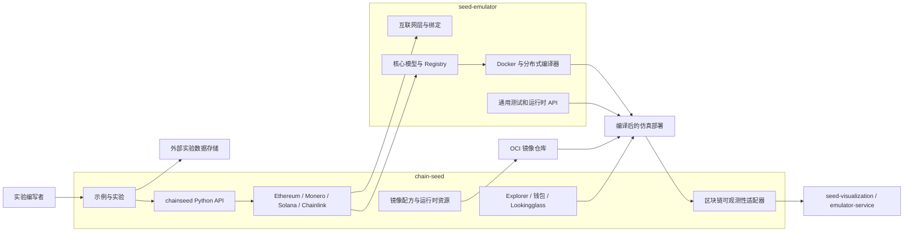
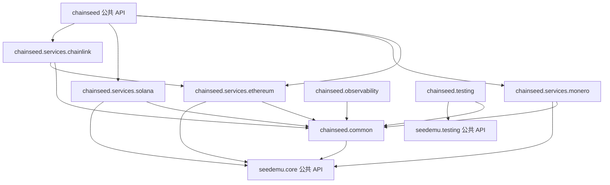
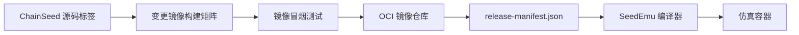
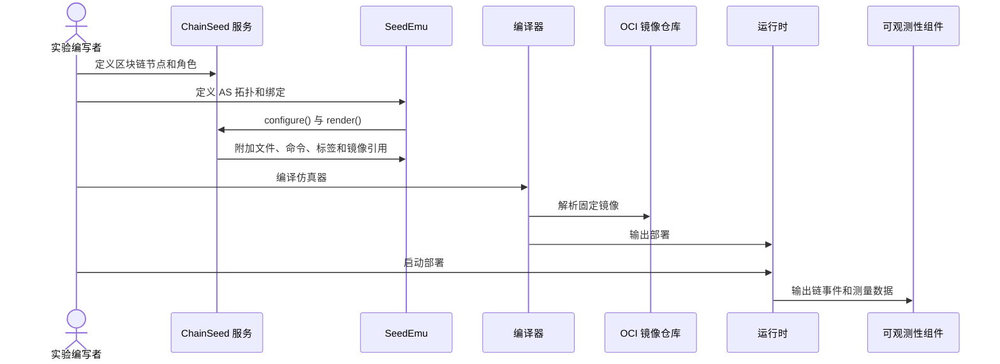
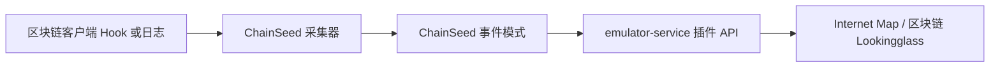

# ChainSeed 目标架构

中文 | [English](architecture.md)

## 系统边界



SeedEmu 软件包、仓库和 CI 均不依赖 ChainSeed。SeedEmu 只测试自身的
通用仿真行为；兼容性测试由 ChainSeed 负责，并以候选 SeedEmu revision
作为输入运行。

## 归属边界

| 关注点 | `seed-emulator` | `chain-seed` |
|---|---|---|
| Internet、AS、网络、路由和绑定 | 负责 | 使用 |
| Emulator Registry 和层生命周期 | 负责 | 扩展 |
| Docker 与分布式编译 | 负责 | 提供节点需求 |
| 通用容器运行时和网络抓包 | 负责 | 使用 |
| Ethereum、Monero、Solana、Chainlink 服务 | 不包含 | 负责 |
| Genesis、账户、钱包和 Faucet | 不包含 | 负责 |
| 区块链客户端镜像配方 | 不包含 | 负责 |
| Explorer 和区块链 Lookingglass | 不包含 | 负责 |
| 区块链示例和运行时测试 | 不包含 | 负责 |
| 大规模实验定义 | 不包含 | 负责 |
| 原始 benchmark 和拓扑数据 | 不包含 | 通过外部清单引用 |

Kubo/IPFS 和通用流量服务保留在 SeedEmu，因为它们不属于某一种区块链
协议。Chainlink 迁移到 ChainSeed，因为其模型依赖 Ethereum 服务和制品。

## 仓库结构

```text
chain-seed/
├── pyproject.toml
├── chainseed/
│   ├── extension.py
│   ├── common/
│   ├── compiler/
│   ├── services/
│   │   ├── ethereum/
│   │   │   └── LookingglassServer/
│   │   ├── monero/
│   │   ├── solana/
│   │   └── chainlink/
│   └── testing/
├── docker_images/
│   ├── ethereum/
│   ├── ethexplorer/
│   ├── monero/
│   ├── solana/
│   └── chainlink/
├── tools/
│   ├── blockchain/
│   ├── ethereum/
│   │   ├── large_scale/
│   │   └── transaction_generator/
│   ├── monero/large_scale/
│   └── solana/large_scale/
├── examples/
│   ├── chainlink/
│   │   └── C00_chainlink/
│   ├── ethereum/
│   │   ├── E00_ethereum_poa/
│   │   ├── ...
│   │   ├── E10_large_scale/
│   │   └── ...
│   ├── monero/
│   │   ├── M00_monero/
│   │   └── M01_large_scale/
│   └── solana/
│       ├── S00_solana/
│       └── S01_large_scale/
├── experiments/legacy/
├── tests/
└── docs/
```

每种链的软件包负责自己的服务层、服务器角色、链配置和运行时制品。
只有至少两种链确实需要同一抽象时，代码才进入 `common/`。

### 核心模块职责

| 模块 | 职责 |
|---|---|
| `extension` | ChainSeed 版本、SeedEmu API 要求、层名称和模式版本 |
| `common.artifacts` | Genesis、账户、端点和发布清单的类型化传递 |
| `common.systems` | 与编译器无关的运行系统 profile |
| `compiler.images` | 各目标平台的 OCI 镜像映射 |
| `compiler.ChainSeedDocker` | ChainSeed 镜像选择与 Monero 覆盖 |
| `common.labels` | 节点发现与可观测性的版本化标签 |
| `common.runtime` | 通用进程启动和就绪声明 |
| `ethereum.service` | PoW、PoA、PoS 网络生命周期和虚拟角色绑定 |
| `ethereum.servers` | Execution、Beacon、Validator、Faucet 和 Utility 角色 |
| `ethereum.genesis` | 生成执行层和共识层 Genesis |
| `ethereum.accounts` | 确定性账户、密钥和 Validator Deposit |
| `monero.service` | Monero 网络生命周期和角色绑定 |
| `monero.servers` | Daemon、Miner 和 Wallet 角色 |
| `monero.network` | 网络身份、Genesis 和 Peer 配置 |
| `solana.service` | Solana 集群生命周期和 Validator 绑定 |
| `solana.servers` | Bootstrap、Validator、RPC 和交易角色 |
| `solana.cluster` | Ledger 初始化、身份、Stake 和 Entrypoint 制品 |
| `chainlink.service` | Oracle 拓扑和 Ethereum 依赖解析 |
| `chainlink.servers` | Chainlink 节点、用户和合约部署角色 |
| `observability` | 区块链事件模式、采集和可视化适配 |
| `testing` | 协议感知的健康、交易、区块和最终性探针 |

## 模块依赖



除 Chainlink 显式依赖 Ethereum 这类协议关系外，各链软件包不得互相
导入，也不得形成循环依赖。库源码推荐显式导入 SeedEmu，使依赖变化更
清楚；已有教学示例可以使用通配符导入，这属于风格和可维护性问题，不是
依赖方向违规。

## SeedEmu 扩展契约

ChainSeed 只依赖一组较小的公共接口，不依赖编译器内部实现。

| 契约 | 必需操作 |
|---|---|
| Layer 生命周期 | 注册、配置、渲染、声明依赖 |
| Service 生命周期 | 安装虚拟服务器、绑定节点、获取目标 |
| Node 规格 | 软件、文件、构建命令、启动命令、标签、存储、端口 |
| 网络模型 | AS/网络查询、地址、接口、绑定和过滤 |
| 制品交换 | 注册生成文件并提供给依赖服务 |
| 运行系统选择 | 通过 `Node.setBaseSystem` 保存 ChainSeed 自有 `SystemProfile` |
| Docker 扩展 | 镜像目录钩子与公开的 `addContainerBundle()` |
| 运行时测试 | 容器列表、标签、命名空间、命令和探针 |
| 扩展元数据 | 名称、版本、SeedEmu API 版本和层名称 |

区块链服务不构造 `DockerImage`，只保存逻辑运行 profile。
`ChainSeedDocker` 是编译器侧适配器，负责镜像对象、平台映射以及可选的
单次部署覆盖。

`ChainSeedDocker` 通过 `_getSystemImageCatalog()` 扩展镜像目录。
EthExplorer 位于 `visualization/`，继承 `ContainerBundle`，通过
`Docker.addContainerBundle()` 接入容器编译流程。Explorer 不再使用编译器子类
的附加 Compose 服务钩子。

公共导入方式必须显式：

```python
from seedemu import Binding, Emulator, Filter
from chainseed.services.ethereum import ConsensusMechanism, EthereumService
```

以下方式被删除：

```python
from seedemu import EthereumService
```

## 扩展元数据与 Dump

`chain-seed` 通过 Python entry point 发布扩展描述符：

```toml
[project.entry-points."seedemu.extensions"]
chainseed = "chainseed.extension:descriptor"
```

当前该描述符只是 ChainSeed 自有元数据，SeedEmu 尚未发现或消费这个 entry
point；用户仍需显式导入服务并调用 `Emulator.addLayer()`。SeedEmu 侧的发现、
制品验证和 dump 集成仍属于后续计划，而且描述符不会用于隐式创建服务。

未来的仿真器 dump 使用带版本的封装：

```json
{
  "format_version": 2,
  "seedemu_version": "x.y.z",
  "extensions": [
    {
      "distribution": "chain-seed",
      "version": "a.b.c",
      "api_version": 1
    }
  ],
  "payload_sha256": "..."
}
```

`Emulator.load` 在反序列化前验证封装。如果缺少扩展，应给出清晰错误，
而不是在导入已删除类时失败。直接切换前生成的 dump 不做迁移。

## 镜像与制品模型

镜像配方与使用它们的 ChainSeed 版本放在一起。构建后的镜像发布到 OCI
仓库，并通过 release manifest 中的 digest 引用。



清单将逻辑角色映射到不可变镜像：

```json
{
  "schema": 1,
  "chainseed_version": "a.b.c",
  "images": {
    "ethereum.pos": "registry/chainseed/ethereum-pos@sha256:...",
    "ethereum.explorer": "registry/chainseed/ethexplorer@sha256:...",
    "monero.node": "registry/chainseed/monero@sha256:...",
    "solana.validator": "registry/chainseed/solana@sha256:..."
  }
}
```

开发环境可以显式覆盖镜像引用，发布示例不得依赖可变的 `latest` 标签。

## 构建与运行时流程



ChainSeed 在编译前生成链专用配置。软件包安装和客户端编译不得在每个
生成节点中重复执行。运行时命令只完成节点身份初始化和进程启动。

## 可观测性

SeedEmu 负责通用容器、网络、控制台、命名空间和抓包 API。ChainSeed
增加具有区块链语义的事件：

- 交易创建、接收、转发、打包和最终确认；
- 区块提议、接收、导入、成为孤块和最终确认；
- 节点角色、链身份、Peer 身份和仿真网络坐标。

ChainSeed 通过带版本的模式和 `emulator-service` 适配器暴露这些事件。
可视化前端使用该适配器，不在 SeedEmu 核心加入区块链代码。



链专用标签使用带版本的命名空间：

```text
org.seedsecuritylabs.chainseed.schema
org.seedsecuritylabs.chainseed.network
org.seedsecuritylabs.chainseed.protocol
org.seedsecuritylabs.chainseed.role
org.seedsecuritylabs.chainseed.node_id
org.seedsecuritylabs.chainseed.client
```

SeedEmu 继续负责通用 AS、节点、地址和网络标签。

## 实验数据

Git 只存储可重现输入和体量较小的派生结果：

- 拓扑和负载配置；
- 脚本与 runbook；
- benchmark 模式和汇总表；
- 外部数据清单及校验和；
- 绘图代码。

原始抓包、生成部署、客户端数据库、容器日志和长时间采样流存储在
外部数据系统中。数据集清单记录：

```text
dataset_id, schema_version, source_uri, sha256, bytes,
created_at, generator_commit, seedemu_version, chainseed_version
```

大规模部署示例分别位于 `examples/ethereum/E10_large_scale/`、
`examples/monero/M01_large_scale/` 和 `examples/solana/S01_large_scale/`，观测与负载工具
位于 `tools/<protocol>/`。生成的部署和采样数据不提交到 Git。

## 版本策略

- SeedEmu 对扩展 API 使用语义化版本。
- ChainSeed 声明 `seedemu >= minimum, < next-breaking`。
- ChainSeed Python 软件包和镜像共享一个发布版本。
- SeedEmu 扩展 API 的破坏性修改要求新的 SeedEmu 主版本。
- 链客户端版本变化记录在 ChainSeed release manifest 中。
- 实验 fork 镜像记录上游提交和补丁集 digest。
