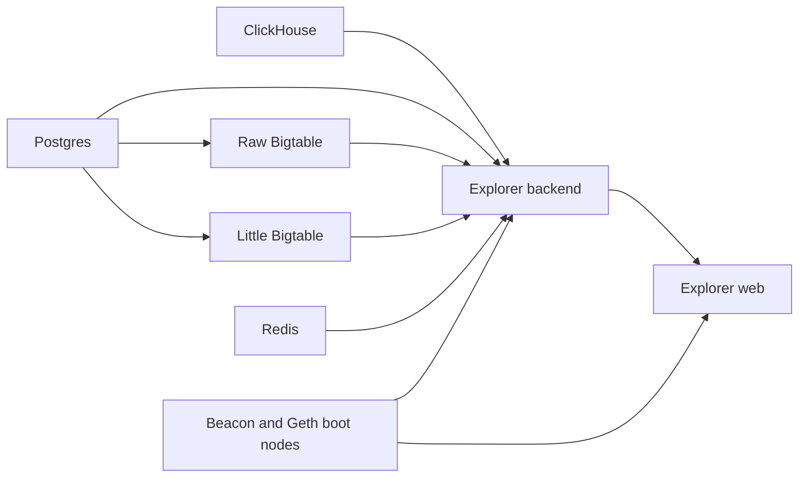
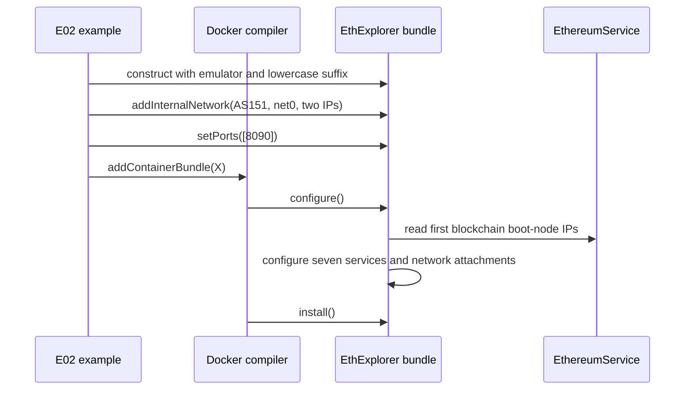

# EthExplorer design

`chainseed.visualization.EthExplorer` is a `seedemu.containerBundle.ContainerBundle`
that adds the Ethereum Beacon Chain explorer stack to a SeedEmu Docker
emulation. The bundle declares seven Compose services and connects its
indexing applications to the emulated Ethereum network.

## Services

| Service key | Role |
| --- | --- |
| `clickhouse` | Analytics and indexed execution data |
| `postgres` | Relational explorer metadata |
| `redis` | Cache and session storage |
| `littlebigtable` | Bigtable-compatible storage |
| `rawbigtable` | Raw Bigtable-compatible storage |
| `ethexplorer-api-server` | Explorer indexing backend |
| `ethexplorer-web` | Explorer web application and API |

All seven services attach to the bundle's external bridge network using static
addresses. The backend and web services also attach to the selected emulated
AS network using two caller-provided addresses.

## Creating and compiling the bundle

For the runnable example, setup commands, and runtime test workflow, see the
[E02 EthExplorer example documentation](../../examples/ethereum/E02_eth_explorer/README.md)
and its [implementation](../../examples/ethereum/E02_eth_explorer/ethereum_pos.py).
The example configures the bundle's emulator network, host port, and Docker
registration before compiling.

The suffix is appended to each service's generated name. Keep it lowercase so
generated Docker image references remain valid. `setPorts()` supplies the host
port mapped to the web container's port `5000`.

The bundle constructor creates the seven containers and configures the default
external network. `configure()` then:

1. Checks that at least one host port was supplied.
2. Reads the first blockchain in `EthereumService` and obtains its Beacon and
   Geth boot-node addresses.
3. Attaches all seven containers to the external network.
4. Configures images, storage settings, health checks, dependencies, and
   application environment variables.
5. Attaches the backend and web containers to the first internal network entry,
   using its first and second addresses respectively.
6. Builds the Compose service and network definitions. `install()` materializes
   container files and build contexts.

## Networks and addresses

The default external network is `ethExplorer_network`, using subnet
`172.20.0.0/24`, gateway `172.20.0.1`, and seven static addresses from
`172.20.0.10` through `172.20.0.16`. It can be replaced through the inherited
`addExternalNetwork()` API. The pool must provide one address for every
container.

The internal network is supplied with `addInternalNetwork(asn, network_name,
ip_addresses)`. EthExplorer consumes the first two addresses for the backend
and web services. The network and addresses must exist and be available in the
rendered emulator. The current E02 example supplies `10.151.0.16` and
`10.151.0.17` on AS151's `net0`.

`joinInternalNetwork()` records the attachment and gateway in the prepared
container configuration. EthExplorer does not add custom commands to replace
the container default route. Backend and web startup scripts run the image's
provisioning script, rewrite storage endpoints, and launch the indexer or web
processes.

## Ethereum endpoints

At configuration time, EthExplorer gets the first blockchain from
`EthereumService`. It uses the first address returned by
`getBeaconBootNodeIP()` as `CL_HOST` and the first address returned by
`getGethBootNodeIP()` as `EL_HOST` for both application containers.

`setBeaconHost()` and `setGethHost()` set explicit host overrides before
configuration. `getBeaconHost()` and `getGethHost()` return the selected values.
The E02 script currently accepts `--explorer-geth` and `--explorer-beacon` CLI
arguments for compatibility, but the current `run()` implementation does not
pass those values to the bundle; the bundle uses boot-node addresses unless
its setters are called directly.

## Startup configuration

The backend and web containers use startup command lists defined in
`chainseed.visualization.EthExplorer`. Each runs the image's
`provision-explorer-config-custom.sh` first. After provisioning, `sed` updates
the generated `config.yml` with the actual static addresses of ClickHouse,
Little Bigtable, Raw Bigtable, and Redis. This ordering preserves the rest of
the configuration created by the image.

The backend starts `eth1indexer`, `rewards-exporter`, and `statistics`. The web
container starts `explorer`, `validator-tagger`, and
`frontend-data-updater`. Both scripts keep their shell process alive after
starting these programs in the background.

## Names and runtime checks

`getContainer()` takes a logical key such as `postgres` or `ethexplorer-web`.
`getName()` returns that logical name, while `getHostname()` returns the
logical name with the configured suffix; the suffixed name is used for Compose
services and build directories.

The E02 example maps host port `8090` to the web container's internal port
`5000`, and `test_runtime.py` defaults to `http://127.0.0.1:8090`. The current
`example.yaml` still checks the legacy service names
`seedemu-ethexplorer-backend` and `seedemu-ethexplorer-web`, and its HTTP
readiness probes still use host port `5000`. Keep these manifest checks in
sync with the generated Compose service names and selected host port when
updating the example's runtime test configuration.

The installed-package smoke test compiles E02 through `ethereum_pos.py`, using
the copied example and the installed ChainSEED package. This exercises the
emulator construction, rendering, bundle configuration, and Docker Compose
generation; it does not build or start the explorer images.
