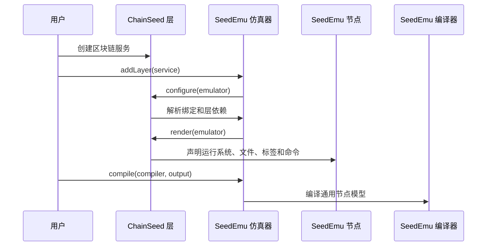
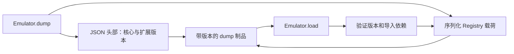
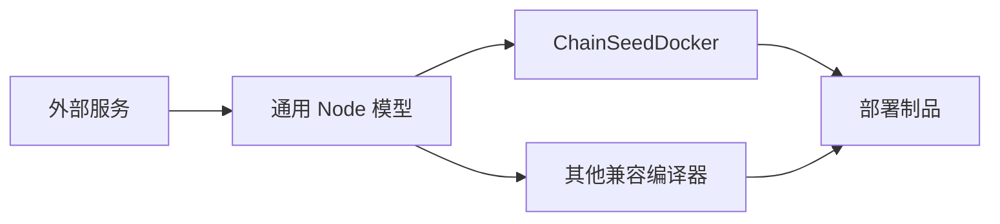

# SeedEmu 集成契约

中文 | [English](seedemu-integration.md)

## 实现状态

ChainSEED 当前适配SeedEmu `Docker` 分支，发行版本为
`0.0.7`。导入时直接检查 `SystemProfile` 和 Docker 扩展钩子；SeedEmu
没有导出 `EXTENSION_API_VERSION`。上游仍保留旧区块链实现。共享网络定义
位于 E00 的 `mini_internet.py`，支持未 render 的网络 bin 导出。

当前两个配套工作区已经实现：

- 显式导入 ChainSeed，并通过普通的 `Emulator.addLayer()` 完成集成；
- 通过现有 `Node.setBaseSystem` API 声明 ChainSeed 自有 `SystemProfile`，并由 `ChainSeedDocker` 完成选择；
- 受保护的 Docker 子类钩子，用于扩展系统镜像目录和附加 Compose 服务，
  由 `ChainSeedDocker` 及其 EthExplorer 组件使用。

SeedEmu 尚未实现、仍属于计划的内容：

- SeedEmu 侧的 entry point 发现和 `requireExtension()`；
- 编译 manifest 中的扩展信息；
- 带版本的 dump 封装和反序列化前验证。

下文描述目标契约。上述计划功能在代码落地前，不应被文档或测试视为已经
可用。

## 计划中的 SeedEmu 拆分结构

```text
seedemu/
├── core/
│   ├── Emulator
│   ├── Layer
│   ├── Service
│   ├── Server
│   ├── Node
│   ├── Registry
│   └── extension
├── layers/
├── compiler/
├── hooks/
├── mergers/
├── services/
│   └── 与具体协议无关的通用服务
└── testing/
    ├── base
    └── runtime
```

该软件包不再包含区块链客户端、链配置、区块链测试探针、浏览器或
区块链专用依赖。

## 集成模式

ChainSeed 中的类仍然是 SeedEmu `Layer`、`Service` 和 `Server` 的普通
外部子类。用户显式创建这些类并将其加入 `Emulator`；SeedEmu 不会动态
导入或自动实例化 ChainSeed。



Python entry point 只用于报告已安装扩展和验证制品，不替代显式导入。

## 公共 API 版本 1

### Emulator 与 Registry

| 操作 | 用途 |
|---|---|
| `addLayer(layer)` | 注册外部层 |
| `getLayer(name)` | 解析已声明的层依赖 |
| `getBindingFor(vnode)` | 将虚拟区块链角色绑定到物理节点 |
| `getServerByVirtualNodeName(vnode)` | 查找其他服务的虚拟服务器 |
| `getRegistry()` | 通过稳定查询访问已渲染节点 |
| `requireExtension(descriptor)` | 记录扩展要求和制品来源 |

外部服务不得依赖 Registry 键布局或 Emulator 私有字段。

### Layer 与 Service

| 操作 | 用途 |
|---|---|
| `addDependency(name, optional, configure)` | 声明渲染顺序 |
| `install(vnode)` | 创建虚拟服务器 |
| `configure(emulator)` | 解析跨层输入 |
| `render(emulator)` | 将服务附加到绑定节点 |
| `getTargets()` | 获取已渲染的服务器与节点对 |

层名称是稳定标识，因为依赖排序和跨服务查找都使用它。ChainSeed 拥有
`EthereumService`、`MoneroService`、`SolanaService` 和
`ChainlinkService` 等名称。

### Node 规格

| 操作 | 用途 |
|---|---|
| `addSoftware(packages)` | 声明操作系统软件包 |
| `addBuildCommand(command)` | 声明镜像构建步骤 |
| `setFile(path, content)` | 写入生成的配置 |
| `importFile(host, guest)` | 导入仓库或运行时制品 |
| `appendStartCommand(command, fork)` | 添加进程启动命令 |
| `setLabel(key, value)` | 添加角色和发现元数据 |
| `addPersistentStorage(path)` | 声明持久化状态 |
| `addSharedFolder(host, guest)` | 挂载实验制品 |
| `addPortForwarding(host, container)` | 暴露 RPC 或界面端口 |
| `setBaseSystem(profile)` | 声明节点需要的运行 profile |

ChainSeed 定义稳定的 `SystemProfile` 标识，例如 `chainseed.ethereum.pos`。
profile 可通过 `subset` 指向镜像所基于的较通用运行环境；因此 Ethereum PoS
包含 `BaseSystem.SEEDEMU_BASE`，而 SeedEmu Base 又包含 Ubuntu 20.04。
只声明已经确认的镜像继承关系；尚未完善的 Chainlink 镜像目前不设置 `subset`。
绑定时会保留兼容且更具体的 profile，互不相关的两个具体 profile 仍然冲突。Docker
镜像选择仍是精确的 profile 查询；体系结构、镜像仓库、tag 和软件元数据保留在
`chainseed.compiler`，不写入 `Node`。

### 运行时测试

SeedEmu 保留以下通用操作：

- 发现容器并读取通用标签；
- 映射容器 PID 并进入命名空间；
- 执行命令或 HTTP 探针；
- 读取资源计数器和抓包结果。

ChainSeed 负责协议解释、链健康探针、交易生成、区块与最终性检查以及
区块链结果模式。

## 扩展描述符

SeedEmu 定义一个小型不可变描述符：

```text
distribution
version
extension_api_version
owned_layer_names
artifact_schema_versions
```

ChainSeed 注册第一个层时，该描述符会附加到 Emulator。编译过程将其
写入 `seedemu-manifest.json`，dump 序列化也记录相同要求。

两个扩展拥有相同层名称时直接报错。不支持的扩展 API 版本在 configure
或 load 之前失败。

## Dump 格式

原始 Registry pickle 文件替换为包含可读头部和校验后载荷的封装：



反序列化前先完成验证，因此没有安装 ChainSeed 时可以给出明确错误，
而不是在导入已移除类时异常退出。该格式是通用设计，也可服务于其他
外部服务仓库。

## 编译器边界

SeedEmu 内置编译器只读取渲染后的通用节点模型，不得导入 ChainSeed，
也不得包含区块链专用镜像选择逻辑。ChainSeed 通过自己的 `Docker` 子类
适配其运行系统。



ChainSeed 服务只写入运行 profile。`ChainSeedDocker` 通过覆写受保护的系统镜像
目录钩子，加入`（profile，目标平台） -> DockerImage` 映射，并在编译时读取
Monero 服务目标以处理可选的自定义镜像。

SeedEmu 的 Docker 编译器在组装 Compose 时还会调用一个受保护的附加服务钩子。
`ChainSeedDocker` 覆写该钩子，从已启用的 ChainSeed 组件收集服务定义，并通过
继承的受保护方法解析仿真网络名称。该受保护的子类扩展点由 `_getSystemImageCatalog()`、
`_getAdditionalComposeServices()` 和 `_getRealNetName()` 组成。SeedEmu 不提供
公开的通用 Compose 注册 API。SeedEmu Docker 保留旧 Explorer 实现，
ChainSEED 使用自己的组件。

Lookingglass 是 EthereumService 下的普通 Server，通过
`createLookingglassServer()` 创建并绑定到仿真主机。它在 configure 阶段汇总所有链的
节点与端点，在 render 阶段写入运行程序和清单，并自动发布宿主机端口。
它通过仿真路由访问客户端，不依赖编译器组件钩子或生成后的 Compose 文件。

## 软件包与导入规则

ChainSeed 本来就应依赖并导入 SeedEmu。这里的边界关注依赖方向和公共 API
稳定性，而不是是否存在导入语句。

允许：

```python
from seedemu import Binding, Emulator, Filter
from seedemu.core import Emulator, Node, Service, Server
from seedemu.compiler import Docker, Platform
from chainseed.compiler import ChainSeedDocker
```

库源码推荐显式导入，这样兼容性变化更容易发现。教学示例可以继续使用
`from seedemu import *`；通配符导入属于可维护性问题，而不是架构违规。

ChainSeed 服务实现中不允许：

```python
from seedemu.compiler.DockerImage import DockerImage
from seedemu.services.EthereumService import EthereumService
```

SeedEmu 公共模块不得导入 `chainseed`、检查 ChainSeed 安装路径或对某个
区块链层名称进行特殊处理。

## ChainSeed 负责的兼容性测试

当前已经实现的兼容性门禁要求 ChainSeed 自有测试套件：

1. 固定版本的 ChainSeed 测试夹具可以导入全部公共扩展接口；
2. 能够渲染最小 Ethereum PoS 拓扑；
3. 能够使用 `ChainSeedDocker` 完成编译；
4. 能够从公开编译制品中验证所选 ChainSeed 镜像，并确认普通 `Docker` 不会静默接受 ChainSeed 系统名称。

扩展元数据与 dump 功能实现后，测试套件还将：

- 验证编译 manifest 中的扩展信息；
- 在安装 ChainSeed 时加载带版本的 dump；
- 未安装 ChainSeed 时以明确错误拒绝相应 dump。

测试代码和执行工作流只存在于 ChainSeed。SeedEmu CI 不安装、不导入、
也不检出 ChainSeed；外部触发器或发布门禁只把候选 SeedEmu revision
传给 ChainSeed 工作流。
