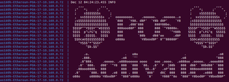

# Ethereum Blockchain (PoS)

This example demonstrates how to create an Ethereum proof-of-stake
private blockchain in the SEED Emulator. The blockchain is started as
a PoS chain from the genesis state. It uses Geth for the execution
layer and Lighthouse for the consensus layer.

The example creates separate Geth nodes, Beacon nodes, and Validator
Client nodes. It also creates a Beacon Setup node, which prepares the
configuration files and genesis data needed by the Beacon nodes and
Validator Clients.




## Table of Content

- [Create the Internet Base](#create-the-internet-base)
- [Create a PoS Blockchain](#create-a-pos-blockchain)
- [Create Pre-funded Accounts](#create-pre-funded-accounts)
- [Create the Beacon Setup Node](#create-the-beacon-setup-node)
- [Create Geth Nodes](#create-geth-nodes)
- [Create Beacon Nodes](#create-beacon-nodes)
- [Set Bootnodes](#set-bootnodes)
- [Create Validator Client Nodes](#create-validator-client-nodes)
- [Create Faucet and Utility Servers](#create-faucet-and-utility-servers)
- [Binding to Physical Nodes](#binding-to-physical-nodes)
- [Generate the Docker Output](#generate-the-docker-output)
- [How to Run](#how-to-run)
- [Access Points](#access-points)
- [Relationship with Other Examples](#relationship-with-other-examples)


## Create the Internet Base

In this example, we emulate the Internet using 10 stub ASes:

```text
150, 151, 152, 153, 154, 160, 161, 162, 163, 164
```

Each stub AS has 3 hosts. The emulator therefore has 30 physical hosts
in total.

```python
hosts_per_stub_as = 3
emu = Makers.makeEmulatorBaseWith10StubASAndHosts(
        hosts_per_stub_as = hosts_per_stub_as)
```

## Create a PoS Blockchain

To create a blockchain, we first create the `EthereumService`, and then
create a blockchain inside this service. The service supports multiple
chains.

```python
eth = EthereumService()
blockchain = eth.createBlockchain(
        chainName="pos",
        consensus=ConsensusMechanism.POS)
```

For a PoS blockchain, the SEED Emulator uses a split Ethereum
architecture:

- Geth nodes run the execution layer.
- Beacon nodes run the consensus layer.
- Validator Client nodes hold validator keys and perform block proposal
  and attestation duties.
- The Beacon Setup node generates and distributes the testnet
  configuration and genesis data.


## Create Pre-funded Accounts

The example creates 10 pre-funded user accounts. These accounts are
derived from a mnemonic using the Ethereum wallet derivation path used
by wallets such as MetaMask.

```python
accounts_total = 10
pre_funded_amount = 1000000
mnemonic = "gentle always fun glass foster produce north tail security list example gain"

blockchain.addLocalAccountsFromMnemonic(
        mnemonic=mnemonic,
        total=accounts_total,
        balance=pre_funded_amount)
```

All accounts created during the build time are added, together with
their balances, to the genesis block. Therefore, their balances are
recognized as soon as the blockchain starts.

Users can import the mnemonic into MetaMask and use the generated
accounts on this private chain.


## Create the Beacon Setup Node

A PoS blockchain needs genesis data for both the execution layer and
the consensus layer. The Beacon Setup node prepares the Beacon chain
configuration, validator key information, deposit data, and genesis
state used by the rest of the PoS nodes.

```python
beaconsetupServer: PoSBeaconSetupServer = \
        blockchain.createBeaconSetupNode("BeaconSetupNode")
emu.getVirtualNode("BeaconSetupNode").setDisplayName(
        "Ethereum-POS-BeaconSetup")
```

The Beacon Setup node does not run as a normal Geth node or Beacon
node. Its main purpose is to generate and serve the bootstrapping data
needed by the other PoS nodes.


## Create Geth Nodes

Geth nodes run the Ethereum execution layer. They maintain the
execution state, process transactions, expose JSON-RPC APIs, and
communicate with Beacon nodes through the authenticated Engine API.

```python
for i in range(geth_node_number):
    gethServer: PoSGethServer = blockchain.createGethNode(
            f"gethnode{i}")
    gethServer.enableGethHttp()
    gethServer.appendClassName(f"Ethereum-POS-Geth-{i+1}")
    gethServer.addHostName(f"gethnode{i}" + DOMAIN)
```

The `enableGethHttp()` API enables the HTTP JSON-RPC interface. This is
useful for applications, tools, MetaMask, Faucet, Utility Server, and
the Eth Explorer.


## Create Beacon Nodes

Beacon nodes run the Ethereum consensus layer. They maintain Beacon
chain state, slots, epochs, validators, attestations, and finality
information. Each Beacon node is connected to one Geth node.

```python
for i in range(beacon_node_number):
    beaconServer: PoSBeaconServer = blockchain.createBeaconNode(
            f"beaconnode{i}")
    beaconServer.appendClassName(f"Ethereum-POS-Beacon-{i+1}")
    beaconServer.connectToGethNode(
            f"gethnode{(i+1)%len(geth_nodes)}")
```

The Beacon node talks to its connected Geth node through the Engine API.
This is how the consensus layer asks the execution layer to build,
validate, and import execution payloads.


## Set Bootnodes

The example sets one Geth node and one Beacon node as bootnodes.
Bootnodes help other nodes discover peers when the private chain starts.

```python
geth_nodes[0].setBootNode(True)
beacon_nodes[0].setBootNode(True)
```

The Geth bootnode is used by execution-layer nodes. The Beacon bootnode
is used by consensus-layer nodes.


## Create Validator Client Nodes

Validator Client nodes hold validator keys and connect to Beacon nodes.
They do not maintain the whole Beacon chain state themselves. Instead,
they rely on Beacon nodes to provide duties and unsigned blocks or
attestations, then sign the required messages with validator keys.

```python
for i in range(vc_node_number):
    VcServer: PoSVcServer = blockchain.createVcNode(f"vcnode{i}")
    VcServer.appendClassName(f"Ethereum-POS-Validator-{i+1}")
    VcServer.connectToBeaconNode(
            f"beaconnode{(i+1)%len(beacon_nodes)}")
    VcServer.enablePOSValidatorAtGenesis()
```

This example enables all Validator Client nodes at genesis. This means
their validators are part of the initial Beacon state, so they can
participate in block proposal and attestation after the PoS network
starts.

Adding validators after the chain has started is demonstrated in the
[E07_validator](../E07_validator) example.


## Create Faucet and Utility Servers

The example also creates a Faucet server and a Utility server. These
servers are useful for later examples and for interacting with the
private chain.

```python
faucet: FaucetServer = blockchain.createFaucetServer(
        vnode="faucet",
        port=80,
        linked_eth_node="gethnode1",
        balance=10000,
        max_fund_amount=10)
faucet.setDisplayName("Faucet")
```

The Faucet server can fund user accounts during runtime.

```python
util_server: EthUtilityServer = blockchain.createEthUtilityServer(
        vnode="utility",
        port=5000,
        linked_eth_node="gethnode2",
        linked_faucet_node="faucet")
util_server.setDisplayName("UtilityServer")
```

The Utility server can deploy smart contracts and provide contract
addresses to other applications.


## Binding to Physical Nodes

All virtual nodes need to be bound to physical nodes. This example
binds all Ethereum-related virtual nodes to hosts in the base Internet
topology.

```python
for _, servers in blockchain.getAllServerNames().items():
    for server in servers:
        emu.addBinding(Binding(
                server,
                filter=Filter(nodeName="host_*"),
                action=Action.FIRST))
```


## Generate the Docker Output

The example enables both the Internet Map and the Eth Explorer when
compiling the Docker output.

```python
from chainseed.visualization import EthExplorer

docker = ChainSeedDocker(internetMapEnabled=True, platform=platform)
if ether_view_enabled:
    docker.addContainerBundle(EthExplorer(emu, chain_name="pos"))

emu.compile(docker, output, override=True)
```

The Internet Map shows the emulated Internet topology. The Eth Explorer
shows the Ethereum PoS chain state, including slots, epochs, blocks,
validators, and execution-layer transactions.

`ether_view_enabled` is controlled by command-line options. It is enabled by
default for manual runs, and can be disabled for CI:

```bash
python3 ethereum_pos.py --no-eth-explorer
```


## How to Run

Run the standardized test workflow from the repository root:

```bash
tools/run-example-test.sh E01 compile
tools/run-example-test.sh E01 all
```

The test manifest splits validation across lifecycle stages:

- `runtime.readiness` checks that the expected Geth, Beacon, Validator,
  Beacon Setup, Faucet, and Utility containers are running.
- `probes` checks key runtime facts: Geth/Lighthouse processes are
  active, the Beacon Setup node produced `genesis.ssz`, Geth exposes a
  local funded account, and the PoS chain advances execution blocks.
- `test_programs` runs the stateful transaction test: it sends a signed
  ETH transfer and verifies the receipt plus both account balance
  changes.

For manual use, run the following commands from this example directory:

```bash
python3 ethereum_pos.py [amd|arm]
cd output
docker compose up
```

Arguments:

- `amd`: Generate Docker configuration for AMD64. This is the default.
- `arm`: Generate Docker configuration for ARM64 hosts.
- `--platform amd|arm`: Standard test-framework platform argument.
- `--output DIR`: Standard test-framework output directory argument.
- `--eth-explorer`: Enable the ChainSeed EthExplorer stack. This is the default for manual
  runs.
- `--no-eth-explorer`: Disable the ChainSeed EthExplorer stack. The test manifest uses this
  option for CI.

Startup may take some time. The Geth nodes, Beacon nodes, Validator
Clients, Beacon Setup node, Faucet, Utility Server, Internet Map, and
Eth Explorer all need to initialize.


## Access Points

After the emulator starts, the following services are commonly used:

| Service | Default URL | Function |
| --- | --- | --- |
| Internet Map | `http://127.0.0.1:8080/map.html` | Shows the emulated Internet topology |
| Eth Explorer | `http://127.0.0.1:5000` | Shows the Ethereum PoS private chain |
| Geth HTTP RPC | `http://<geth-ip>:8545` | Allows tools and wallets to interact with the execution layer |
| Beacon API | `http://<beacon-ip>:8000` | Allows tools to inspect consensus-layer state |

The exact Geth and Beacon node IP addresses can be found from
`docker compose ps`, the Internet Map, or the generated Docker
Compose file.


## Relationship with Other Examples

This example is the base PoS example. Other examples build on top of
it:

- [E02_eth_explorer](../E02_eth_explorer) focuses on the Eth Explorer.
- [E04_faucet](../E04_faucet) demonstrates account funding through the
  Faucet server.
- [E05_deploy_contract](../E05_deploy_contract) demonstrates smart
  contract deployment through the Utility server.
- [E07_validator](../E07_validator) demonstrates adding a validator
  after the chain has started.
